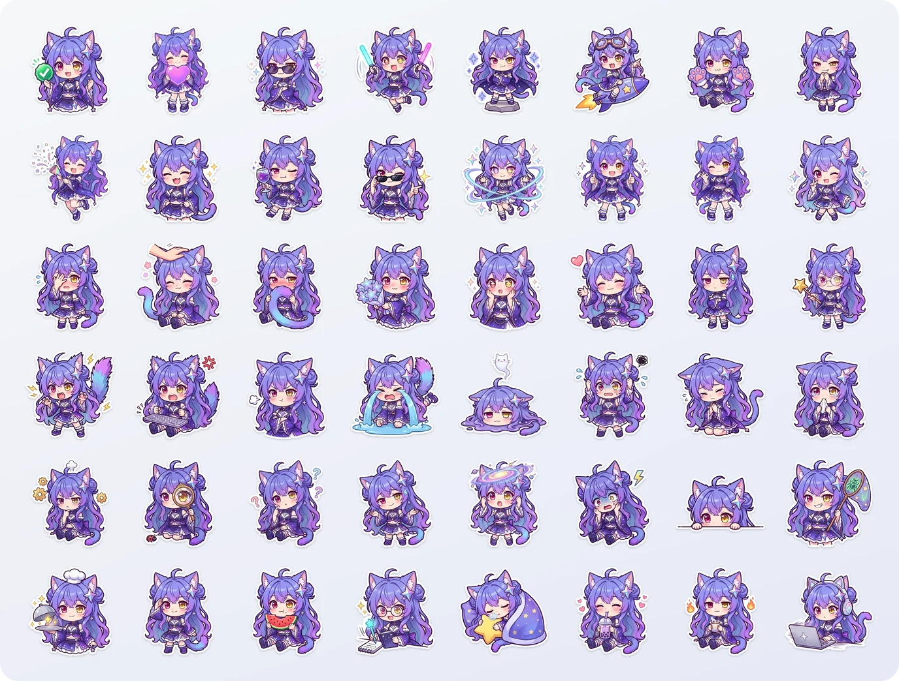

<div align="center">

# agy-meme (Neko Meme Stickers)

**Bidirectional reaction stickers, inline composer picker & MCP server for Google Antigravity Desktop**

[English](./README.md) | [简体中文](./README.zh-CN.md)

[](./LICENSE)
[](#architecture)
[](#installation)
[](https://m8ven.ai/mcp/jiangnanquan-agy-meme-1mifsd?s=readme)

</div>

`agy-meme` gives your AI assistant expressive reaction stickers inside **Antigravity Desktop** chat bubbles — while staying completely silent in terminal / CLI sessions (`agy`, `agycli`, IDE, ACP).

It bundles 48 universal, zero-text, 100% style-consistent RGBA die-cut purple-blue heterochromia neko WebP stickers (`gemini-neko` v2.2 — universally understood across all languages with bilingual search & `scene` semantic routing) across 6 moods (`happy`, `angry`, `sad`, `shy`, `confused`, `daily`) and works **both standalone on vanilla English Antigravity Desktop and stacked cleanly on top of [`agy-desktop-exo`](https://github.com/jiangnanquan/agy-desktop-exo) / [`antigravity-desktop-cn`](https://github.com/Silas-02/antigravity-desktop-cn)**.

<p align="center">
  
</p>

---

## Features

- **Bidirectional Bubble Rendering**:
  - AI responses containing `[表情: 描述]` automatically render as crisp inline sticker cards (default 148px with click-to-lightbox zoom, right-click actions, and toggleable/clean mode).
  - User messages sent with stickers also render cleanly inside `[data-testid="user-message-bubble"]`.
- **Inline Composer Sticker Picker (`Cmd+Shift+M` / `Ctrl+Shift+M`)**:
  - Mood tabs (`happy`, `angry`, `sad`, `shy`, `confused`, `daily`), keyword search, recently used strip, click-to-insert vs click-to-send toggle, and one-click custom local image import.
- **Native MCP Server (`server.mjs`, zero npm dependencies)**:
  - Tools: `send_meme`, `meme_list`, `learn_meme`, `meme_update`.
  - Reads `~/.gemini/meme-packs/` (seeded automatically from the bundled `packs/gemini-neko/` pack on first launch via copy-on-write, so your custom stickers survive plugin upgrades).
- **Strict CLI Isolation (`Desktop` vs `CLI`)**:
  - Host process detection checks `PLUGIN_DATA` + process tree (`/bin/ps` on POSIX) so `send_meme` / `meme_list` refuse to run in `agy` CLI / IDE / ACP hosts, and `rules/AGENTS.md` enforces the same host gate on the prompt side.
- **Non-Destructive ASAR Overlay**:
  - `./install.sh` layers only the marked Meme IPC + Renderer blocks onto Antigravity's `app.asar` (works on vanilla English Antigravity OR on top of localized `antigravity-desktop-cn`).
  - `./uninstall.sh` cleanly strips only the Meme blocks without removing Chinese localization or other tweaks.
- **Settings UI Card**:
  - Automatically mounts sticker controls inside **Settings -> Appearance** (or **Chat Width** / **设置 -> 外观 -> 聊天宽度**), supporting enable toggle, auto-send vs insert mode, compact sticker size, and pack refresh.

---

## Architecture

```text
agy-meme/
├── plugin.json                # Antigravity plugin manifest
├── mcp_config.json            # Portable stdio MCP launch config (${PLUGIN_ROOT})
├── server.mjs                 # Zero-dependency Node.js ESM MCP server
├── assets/logo.svg            # Plugin icon (1:1 heterochromia neko emblem)
├── rules/AGENTS.md            # Desktop host gate & sticker collaboration rules
├── skills/agy-meme/SKILL.md   # Slash / agent skill instructions
├── packs/gemini-neko/         # 48 universal text-free RGBA die-cut WebP stickers + memes.json
├── scripts/meme_patcher.js    # Cross-platform Electron ASAR overlay patcher
├── install.sh / install.ps1   # One-command installer (macOS / Linux / Windows)
└── uninstall.sh               # Non-destructive uninstaller
```

Two complementary layers work together:
1. **Standard Antigravity Plugin (`plugin.json` + `server.mjs` + `rules/` + `skills/`)**: gives the agent `send_meme` / `meme_list` / `learn_meme` / `meme_update` MCP tools and Desktop-only prompt rules.
2. **Electron ASAR Renderer Overlay (`scripts/meme_patcher.js`)**: renders `[表情: ...]` tags as real WebP stickers inside Antigravity Desktop's chat bubbles and adds the `Cmd/Ctrl+Shift+M` composer picker (pure Node.js Electron ASAR parser + macOS ad-hoc Inside-Out re-signing, zero external binary dependencies).

---

## Requirements

- **Antigravity Desktop** (macOS Apple Silicon/Intel, Windows, or Linux)
- **Node.js 18+** (`node -v`)

---

## Installation

> Note: Run `./install.sh` from a standalone system terminal (Terminal / iTerm2 / Ghostty / PowerShell), **not** from Antigravity Desktop's built-in terminal, so restarting Antigravity Desktop to apply the ASAR overlay does not terminate your shell mid-install. (`--plugin-only` is safe anywhere.)

### macOS / Linux

```bash
git clone https://github.com/jiangnanquan/agy-meme.git
cd agy-meme
./install.sh
```

Or install the plugin manifest first via the Antigravity CLI, then apply the Desktop renderer overlay:

```bash
agy plugin install https://github.com/jiangnanquan/agy-meme
bash ~/.gemini/config/plugins/agy-meme/install.sh
```

### Windows (PowerShell)

```powershell
git clone https://github.com/jiangnanquan/agy-meme.git
cd agy-meme
.\install.ps1
```

### MCP Plugin Only (Skip ASAR Renderer Patch)

```bash
./install.sh --plugin-only
```

### Check Status / Uninstall

```bash
# Read-only status check
node scripts/meme_patcher.js --status

# Non-destructive strip of Meme renderer + IPC (preserves localization if stacked)
./uninstall.sh

# Full removal including plugin files (add --purge-packs to also remove ~/.gemini/meme-packs)
./uninstall.sh --purge-plugin
```

---

## Stacking With `antigravity-desktop-cn`

If you also use `antigravity-desktop-cn`:
1. Install or upgrade localization first (`antigravity-desktop-cn/install.sh`).
2. Run `agy-meme/install.sh` — `meme_patcher.js` detects your localized `app.asar` and overlays only the Meme IPC and renderer blocks on top.
3. Uninstalling `agy-meme` leaves Chinese localization intact.

---

## Credits & License

- Character visual design pays homage to **ZipZipPipe**'s iconic heterochromia Gemini catgirl (indexed in [`shuaizenge/ai-girls`](https://github.com/shuaizenge/ai-girls) and [`lmy414/ai-girl-stickers`](https://github.com/lmy414/ai-girl-stickers)); built-in `gemini-neko` v2.2 provides 48 unified, language-agnostic chibi die-cut stickers understood worldwide.
- Released under the [MIT License](./LICENSE).
