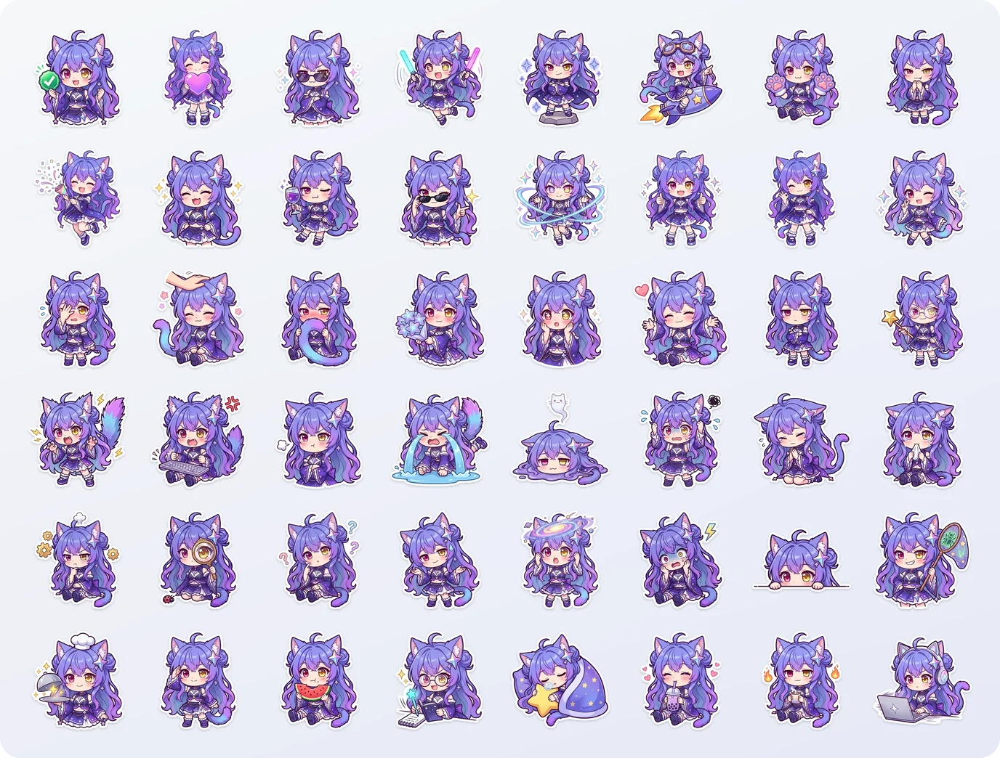

<div align="center">

# agy-meme（Gemini 猫娘表情包插件）

**专为 Google Antigravity Desktop 打造的双向表情包渲染、输入框贴纸面板与 MCP 插件**

[English](./README.md) | [简体中文](./README.zh-CN.md)

[](./LICENSE)
[](#架构设计)
[](#快速安装)
[](https://m8ven.ai/mcp/jiangnanquan-agy-meme-1mifsd?s=readme)
[](https://glama.ai/mcp/servers/jiangnanquan/agy-meme)

</div>

`agy-meme` 让 AI 助手在 **Antigravity Desktop** 对话中用生动的紫蓝异色瞳猫娘表情包与你互动——同时在终端 / CLI 会话（`agy`、`agycli`、IDE、ACP）中**自动静默隔离**，绝不向终端吐出无法渲染的 `[表情: ...]` 文本标签。

内置 48 张全球零语言障碍、画风 100% 统一的高清透明模切 `gemini-neko` v2.2 WebP 表情贴纸（全套纯动作与视觉符号传情、零文字窄梗束缚，支持中英双语检索与 `scene` 画面实况语义路由，覆盖 `happy` / `angry` / `sad` / `shy` / `confused` / `daily` 六大情绪），既可**独立安装在英文原版 Antigravity Desktop**，也可**无损叠加在 [`agy-desktop-exo`](https://github.com/jiangnanquan/agy-desktop-exo) / [`antigravity-desktop-cn`](https://github.com/Silas-02/antigravity-desktop-cn) 中文增强汉化版之上**。

<p align="center">
  
</p>

---

## 核心特性

- **双向聊天气泡渲染**：
  - AI 回复中的 `[表情: 描述]` 自动渲染为高清 WebP 贴纸卡片（支持点击灯箱大图放大、右键操作）。
  - 用户通过面板发送的表情也会在 `[data-testid="user-message-bubble"]` 气泡中正确渲染。
- **输入框猫娘表情面板（快捷键 `Cmd+Shift+M` / `Ctrl+Shift+M`）**：
  - 支持情绪分组切换、关键词搜索、最近使用记录、点选即发 / 点选插入双模式，以及一键从本地导入自定义图片扩充图库。
- **零外部依赖原生 MCP 服务（`server.mjs`）**：
  - 提供 `send_meme`、`meme_list`、`learn_meme`、`meme_update` 四个 MCP 工具。
  - 图库采用写时复制（Copy-on-Write）设计：首次启动自动将随插件分发的 `packs/gemini-neko/` 初始化到 `~/.gemini/meme-packs/`，后续插件升级不会覆盖你的自定义贴纸与描述微调。
- **严格区分桌面端与 CLI（环境门禁双保险）**：
  - 服务端通过宿主进程探测（`PLUGIN_DATA` + POSIX 进程树追溯）识别 `agy` CLI / IDE / ACP 会话并自动拒绝调用；
  - `rules/AGENTS.md` 同步约束 Agent 在非桌面端完全静默隔离。
- **无损 ASAR 叠加注入与剥离**：
  - `./install.sh` 仅以标记块形式将 Meme 渲染器与 IPC 叠加到当前 `app.asar`；
  - `./uninstall.sh` 仅精准剥离 Meme 标记块，完好保留 `antigravity-desktop-cn` 的中文汉化与扩展增强。
- **设置面板原生集成**：
  - 自动挂载到 **设置 → 外观 → 聊天宽度**（英文原版挂载于 **Settings → Appearance → Chat Width**）设置卡片，可随时开关贴纸渲染、切换点击直发与小图模式。

---

## 架构设计

```text
agy-meme/
├── plugin.json                # Antigravity 插件清单
├── mcp_config.json            # 可移植 stdio MCP 启动配置（${PLUGIN_ROOT}）
├── server.mjs                 # 零依赖 Node.js ESM MCP 服务
├── assets/logo.svg            # 插件图标（1:1 异色瞳猫娘徽标）
├── rules/AGENTS.md            # 桌面端门禁与表情包协作规范
├── skills/agy-meme/SKILL.md   # 技能说明与使用指引
├── packs/gemini-neko/         # 48 张全统一无字透明模切 WebP 猫娘贴纸与语义索引
├── scripts/meme_patcher.js    # 跨平台 Electron ASAR 叠加补丁器（纯 Node.js）
├── install.sh / install.ps1   # 一键安装脚本（macOS / Linux / Windows）
└── uninstall.sh               # 无损卸载脚本
```

插件由两层协同工作：
1. **标准 Antigravity 插件层（`plugin.json` + `server.mjs` + `rules/` + `skills/`）**：为 Agent 注入 MCP 工具与桌面端门禁规范。
2. **桌面端 ASAR 渲染叠加层（`scripts/meme_patcher.js`）**：纯 Node.js 解析并叠加写入 `app.asar`（macOS 自动执行 Inside-Out ad-hoc 重签，零 Python/外部二进制依赖），将 `[表情: ...]` 真实渲染到客户端界面并挂载快捷键选图面板。

---

## 环境要求

- **Antigravity Desktop**（macOS Apple Silicon / Intel、Windows 或 Linux）
- **Node.js 18+**（`node -v`）

---

## 快速安装

> 提示：执行全量桌面注入 `./install.sh` 时，请在**系统独立终端**（Terminal / iTerm2 / Ghostty / PowerShell）中运行，避免在 Antigravity 内置终端重启客户端时中断当前会话；若仅同步插件与图库，可在任意终端使用 `--plugin-only`。

### macOS / Linux

```bash
git clone https://github.com/jiangnanquan/agy-meme.git
cd agy-meme
./install.sh
```

若你已通过官方 CLI 安装本插件，也可直接叠加启用桌面渲染器：

```bash
agy plugin install https://github.com/jiangnanquan/agy-meme
bash ~/.gemini/config/plugins/agy-meme/install.sh
```

### Windows (PowerShell)

```powershell
git clone https://github.com/jiangnanquan/agy-meme.git
cd agy-meme
.\install.ps1
```

### 仅安装 MCP 插件（不注入桌面 ASAR）

```bash
./install.sh --plugin-only
```

### 查看状态与无损卸载

```bash
# 只读查看当前桌面端注入状态
node scripts/meme_patcher.js --status

# 仅剥离 Meme 补丁（叠加汉化时完好保留中文汉化）
./uninstall.sh

# 彻底卸载并删除插件目录（加 --purge-packs 可一并删除 ~/.gemini/meme-packs）
./uninstall.sh --purge-plugin
```

---

## 与 `antigravity-desktop-cn` 叠加使用

若你同时使用 [`antigravity-desktop-cn`](https://github.com/Silas-02/antigravity-desktop-cn)：
1. 先运行汉化安装脚本（`antigravity-desktop-cn/install.sh`）。
2. 再运行 `agy-meme/install.sh`，补丁器会自动保留汉化内容并在其上叠加 Meme 渲染器。
3. 若使用 `q-zh-agent` 多端汉化中枢，执行同步后会自动在汉化之上串联叠加 `agy-meme`。

---

## 致谢与协议

- 角色视觉致敬画师 **ZipZipPipe** 原创的紫蓝星空猫耳异色瞳 Gemini 娘设定（参见 [`shuaizenge/ai-girls`](https://github.com/shuaizenge/ai-girls) 与 [`lmy414/ai-girl-stickers`](https://github.com/lmy414/ai-girl-stickers)）；内置 `gemini-neko` v2.2 贴纸库为全套 48 张统一 Q 版无字透明模切贴纸，无语言门槛、全球通用。
- 本项目基于 [MIT License](./LICENSE) 开源发布。
